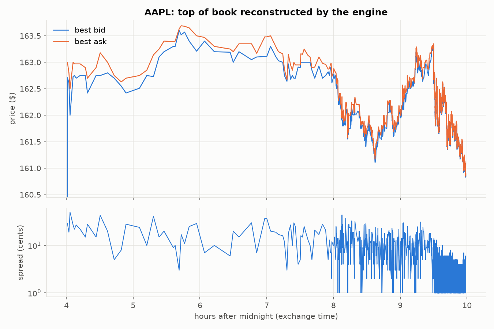

# orderbook: a C++20 limit order book matching engine

[](https://github.com/OWNER/orderbook/actions/workflows/ci.yml)
<!-- Replace OWNER with your GitHub user/org after pushing. -->

This is a price-time priority matching engine. It is validated three ways:

* against a deliberately simple reference implementation, by differential fuzzing;
* against **real NASDAQ ITCH 5.0 data**: 98–100% of real exchange executions
  are reproduced trade for trade;
* under ASan/UBSan/TSan in CI.

It also includes a measured optimisation story, from a `std::map` baseline to a
tuned book that is **3.7× faster on real AAPL order flow**.

## Two-minute overview

* **Engine** (`include/ob/book.hpp`):
  * flat price-level array with intrusive FIFO queues per level
  * cached best bid/ask, plus a hierarchical bitset to find the next best level
    in ≤ 2·⌈log64 levels⌉ word reads
  * pre-allocated index-addressed order pool and an open-addressing id map
  * events (Ack/Trade/Cancel/Reject) written into a pre-allocated buffer, with
    no virtual callbacks and no allocation on the hot path
* **Order types:** limit (GTC), IOC, FOK, market (IOC/FOK), cancel, modify.
  A quantity decrease keeps priority; a price change or increase loses it and
  may cross.
* **Correctness:**
  * 117 unit/property tests run against all five book variants.
  * A differential fuzzer checks the reference and the fast books for identical
    events and identical queue state after every message: 20M messages and
    1,000 seeds clean locally, and a planted bug was caught in 127 messages.
  * A libFuzzer target, and sanitizer builds in CI.
* **Real data:**
  * A streaming ITCH 5.0 parser/replayer. Each exchange execution is replayed
    as an aggressor and must hit the same maker in our book.
  * A LOBSTER parser/replayer with snapshot-by-snapshot checking.
* **Stretch goals, all done:**
  * a lock-free **SPSC ring** feeding the engine from another thread, with
    end-to-end latency measured;
  * a **market-making strategy** backtested against replayed AAPL data, with
    P&L, inventory, drawdown and markouts;
  * **pybind11 bindings** with numpy outputs and plotting scripts.

## Results (Apple M2, clang 17, `-O3 -march=native`; see [docs/benchmarks.md](docs/benchmarks.md))

Real AAPL order flow, 324k messages (NASDAQ ITCH, 2019-01-30):

| Version | Throughput (M msg/s) | p50 | p99 | p99.9 | p99.99 |
|---|---|---|---|---|---|
| Baseline (`std::map` + `std::list`) | 11.16 | 83 ns | 208 ns | 250 ns | 3.29 µs |
| + flat levels | 18.27 | 83 ns | 125 ns | 208 ns | 375 ns |
| + pool allocator | 26.77 | ≤42 ns | 167 ns | 208 ns | 292 ns |
| + flat hash map | 34.02 | ≤42 ns | 167 ns | 250 ns | 333 ns |
| + cache tuning (32 B order) | **41.57** | ≤42 ns | 167 ns | 208 ns | 292 ns |

On Apple Silicon the user-space timer ticks every 41.7 ns, so per-message
percentiles are quantised to that step. Throughput is the precise number on
this machine: mean cost is 90 ns per message for the baseline and 24 ns for the
tuned book. p50 is well under 1 µs, but the max is not (OS noise on an
unisolated core, 20–400 µs), and that is reported as measured.

SPSC pipeline, paced at 1M msg/s: end-to-end p50 167 ns, p99 333 ns.



## Build & run

Requirements: a C++20 compiler (GCC ≥ 12, Clang ≥ 15, Apple clang ≥ 15) and
CMake ≥ 3.20. Catch2 and pybind11 are fetched automatically.

```bash
cmake -S . -B build -G Ninja -DCMAKE_BUILD_TYPE=Release
cmake --build build
ctest --test-dir build --output-on-failure        # unit + fuzz tests
./build/ob_fuzz_diff --seeds 1000 --messages 20000  # long differential fuzz

# Real data: streams the start of NASDAQ's public ITCH sample (~600 MB)
./scripts/fetch_itch.sh                            # -> data/aapl.obm, spy.obm, qqq.obm
./build/ob_replay itch --input <(gunzip -c data/itch_raw/01302019_head.gz) --symbol AAPL --diff

# Benchmarks
./build/ob_bench --stream data/aapl.obm --repeats 7 --out-dir results/aapl
./build/ob_bench --synthetic 2000000
./build/ob_e2e_bench --stream data/aapl.obm --rate 1000000
CPU=3 ./scripts/bench_linux.sh data/aapl.obm       # Linux: governor, pinning, perf stat, flame graph

# Market-making backtest
./build/ob_mm_backtest data/aapl.obm --from 09:30:00 --no-improve --skew 2 --latency 10

# Sanitizers (Linux; Apple's ASan runtime hangs at startup on recent macOS)
cmake -S . -B build-asan -DCMAKE_BUILD_TYPE=RelWithDebInfo -DOB_SANITIZE=address,undefined
```

Python bindings:

```bash
python3 -m venv .venv && .venv/bin/pip install numpy matplotlib
cmake -S . -B build -DOB_BUILD_PYTHON=ON -DPython_EXECUTABLE=$PWD/.venv/bin/python && cmake --build build
PYTHONPATH=build .venv/bin/python -c "import pyob; b=pyob.Book(); print(b.add(1,'buy',100,5))"
PYTHONPATH=build .venv/bin/python python/analysis/plot_book.py data/aapl.obm --out book.png
PYTHONPATH=build .venv/bin/python python/analysis/plot_mm.py data/aapl.obm --out mm.png
```

## Event-driven backtester (ob-sim)

`sim/` is a deterministic, single-instrument exchange simulator built around the book.

* **Replay:** it replays a LOBSTER-format day through the unchanged engine.
* **Fills:** a strategy's passive orders fill by exact queue position, using
  the book's per-order arrival sequence. Aggressive orders walk displayed
  depth, and an `own_taken` counter stops two takes from filling against the
  same shares.
* **Latency:** a configurable model with feed, processing, entry and return
  delays plus seeded jitter. The strategy's own view of its position lags
  the exchange.
* **Accounting:** integer cash, inventory and average-cost PnL, plus
  fill-quality diagnostics (spread capture, adverse selection at 1 s/10 s,
  queue wait).

```bash
# AAPL day in LOBSTER format, built from the ITCH sample (LOBSTER samples are no longer public)
gunzip -c data/itch_raw/01302019_head600M.gz | ./build/ob_itch2lobster --symbol AAPL --out data/AAPL_2019-01-30
./build/sim/ob-sim check --config sim/configs/aapl_mm.json        # parity on every row
./build/sim/ob-sim run   --config sim/configs/aapl_mm.json        # -> runs/aapl_mm/{orders,fills,pnl}.csv, summary.json, manifest.json
./build/sim/ob-sim sweep --config sim/configs/aapl_mm.json --param latency_ns.to_exchange --values 0,10000,50000,200000,1000000,5000000
```

How it was validated (details in [docs/sim_validation.md](docs/sim_validation.md)):

* 21 hand-calculated fill scenarios.
* Accounting identity tests.
* Book parity on all 328,382 AAPL rows.
* A fuzz test of the invariants, and repeat runs with identical output
  hashes (the same with Apple clang and GCC).
* An independent Python model, written from the spec without the C++ source,
  which matches all 212 probe-strategy fills exactly.

Every known bias and its direction is listed in
[docs/sim_biases.md](docs/sim_biases.md). One finding: with trade-through
fills on, the market maker's fill rate *rises* with latency, because stale
quotes get picked off. With trade-through off, it falls as expected.

## Repository layout

```
include/ob/   types.hpp (messages/events), book.hpp (engine), pool.hpp, flat_map.hpp,
              level_bitset.hpp, spsc.hpp, histogram.hpp, timer.hpp, env_info.hpp
src/          explicit template instantiations, printing, environment capture
ref/          reference implementation (std::map + std::list): oracle and baseline
tests/        Catch2 unit tests, differential fuzzer, libFuzzer target, LOBSTER fixture
bench/        ob_bench (per-stage latency/throughput), ob_e2e_bench (SPSC pipeline)
tools/        ITCH 5.0 + LOBSTER parsers/replayers, .obm stream format, synthetic generator
strategy/     market maker + backtester (message-count latency, engine-injected quotes)
sim/          ob-sim: event-driven backtester (exchange sim, latency, portfolio, strategies, tests)
ref_py/       independent Python fill model used to cross-check ob-sim
python/       pybind11 module (pyob) + analysis/plotting scripts
docs/         design.md, benchmarks.md, sim_design.md, sim_validation.md, sim_biases.md, plots
scripts/      fetch_itch.sh, bench_linux.sh, sim_determinism.sh
results/      raw benchmark output, histograms, profiles from the runs quoted above
```

## Design decisions

The full write-up, with complexity table and validation details, is in
[docs/design.md](docs/design.md).

* **One templated engine, policy-swapped stages.** Each benchmark row is the same
  algorithm with one data structure changed, so the table measures data
  structures and nothing else.
* **Indices, not pointers.** 32-bit links halve the queue overhead, and the pool
  can grow by reallocation.
* **Hierarchical bitset** instead of scanning empty ticks. The next-best search
  is bounded by the number of layers, not by price distance.
* **Backward-shift deletion** in the hash map. Order flow is cancel-heavy, and
  tombstones would degrade probes over a trading day.
* **Explicit modify semantics.** A quantity decrease keeps priority; anything
  else is a cancel/replace that loses priority (as on most exchanges).
* **Validation against the exchange itself.** ITCH carries no snapshots, but every
  execution names its maker. Checking that our engine picks the same maker
  tests price-time priority directly.

## Known limitations

* A fixed price band per book. Out-of-band prices are rejected; the tools size
  the band from the data.
* Single instrument, single thread per book.
* No self-trade prevention, iceberg, pegged or hidden orders, or auctions.
* LOBSTER's free samples are no longer publicly downloadable. The LOBSTER path
  is tested on a fixture only, and the real-data validation uses ITCH.
* The benchmarks were run on macOS. There is no core isolation, no `perf`, and
  the timer resolution is 42 ns. The Linux script provides the missing pieces
  but has not been run for these results.
* The market-making backtest has no market impact, and historical order sizes
  are replayed as-is. The naive strategy **loses money** on this sample
  (adverse selection on a volatile post-earnings open). That is reported, not
  tuned away.
