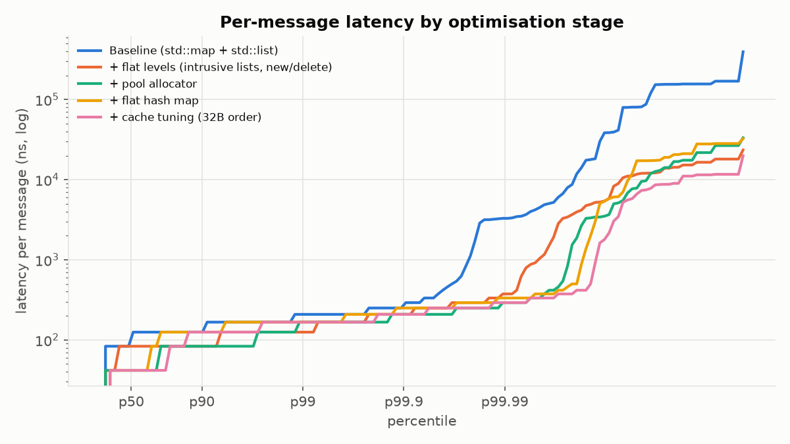

# Benchmarks

All numbers below were measured on the machine described here. They are **this
machine's numbers**, not a claim about yours. Re-run with
`scripts/bench_linux.sh` on an isolated Linux core for publishable results.

## Environment

| Item | Value |
|---|---|
| CPU | Apple M2 (4P + 4E cores, 8 logical) |
| OS | macOS (Darwin 25.5.0, arm64) |
| Platform | bare metal (`kern.hv_vmm_present = 0`) |
| Compiler | Apple clang 17.0.0 |
| Flags | `-O3 -DNDEBUG -march=native` (Release) |
| Core pinning / governor | **not available on macOS**: no hard affinity API, no core isolation, OS-managed DVFS. The bench raises thread QoS to user-interactive, which keeps it on P-cores in practice. |
| Timer | `cntvct_el0`, 24 MHz → **41.7 ns per tick** |

**Timer resolution caveat.** On Apple Silicon the only user-space counter ticks
every 41.7 ns. Per-message percentiles are therefore quantised to multiples of
~42 ns: "42" means "less than about 42 ns", and two versions with the same p50 are
not necessarily equally fast. On this machine **throughput is the precise
metric**. Its reciprocal is the mean cost per message (e.g. 41.6 M msg/s ≈
24 ns/msg). On x86 the harness uses `rdtsc` (sub-ns resolution) and the
percentiles become meaningful at the low end.

## Method

* Messages are fully loaded into memory before timing (`.obm` binary or
  generated in memory), so parsing is never measured.
* For each version: 1 untimed warm-up pass, then R repeats. A fresh book is
  constructed for every repeat, outside the timed region.
* **Throughput pass:** one clock read around the whole stream, with the
  `EventBuffer` cleared per message as a real consumer would. Reported as the
  median, with min and max, across repeats.
* **Latency pass:** a timestamp before and after each `process()` call, recorded
  as raw ticks into an HDR-style log-linear histogram (≤ 0.1% relative error)
  and converted to ns at the end. A back-to-back timer pair measured p50 0 ticks
  and p99 1 tick.
* Workloads:
  * **AAPL**: 324,144 engine messages reconstructed from NASDAQ ITCH 5.0
    (2019-01-30, 04:00–09:58). Includes real cancel churn and real aggressor
    flow (each exchange execution is replayed as an IOC). 7 repeats.
  * **Synthetic**: 2,000,000 messages with a random-walk mid. 50% adds clustered
    near the touch, 36% cancels, 8% modifies, ~6% market orders. 8% of adds are
    aggressive, and some are IOC/FOK. 5 repeats.

## Results: optimisation table

### Real data (AAPL, ITCH 5.0)

| Version | Throughput (M msg/s) | p50 (ns) | p99 (ns) | p99.9 (ns) | p99.99 (ns) | max (ns) |
|---|---|---|---|---|---|---|
| Baseline (`std::map` + `std::list`) | 11.16 | 83 | 208 | 250 | 3,292 | 395,125 |
| + flat levels (intrusive lists, still `new`/`delete`) | 18.27 | 83 | 125 | 208 | 375 | 23,500 |
| + pool allocator | 26.77 | 42 | 167 | 208 | 292 | 33,375 |
| + flat hash map | 34.02 | 42 | 167 | 250 | 333 | 32,542 |
| + cache tuning (32 B packed order) | **41.57** | 42 | 167 | 208 | 292 | 19,917 |

That is **3.7× throughput** end to end, and the p99.99 tail drops from 3.3 µs to
0.3 µs. Mean cost per message falls from 90 ns to 24 ns.



### Synthetic flow

| Version | Throughput (M msg/s) | p50 (ns) | p99 (ns) | p99.9 (ns) | max (ns) |
|---|---|---|---|---|---|
| Baseline (`std::map` + `std::list`) | 17.36 | 83 | 167 | 375 | 59,708 |
| + flat levels | 21.80 | 42 | 125 | 292 | 39,375 |
| + pool allocator | 28.95 | 42 | 125 | 208 | 37,917 |
| + flat hash map | 29.28 | 42 | 167 | 250 | 63,000 |
| + cache tuning | **29.85** | 42 | 167 | 250 | 50,875 |

Max values (20–400 µs) are single outliers: OS interrupts and preemption on an
unisolated core. They vary from run to run and should not be read as properties
of the data structures.

## What each step bought, and why

1. **Flat levels (+64% AAPL, +26% synthetic).** This removes the red-black tree:
   no O(log n) descent and no rebalancing on level create/erase. The profile
   showed `__tree_balance_after_insert`, `__tree_remove` and `erase_order`
   prominent in the baseline. The tail improves the most, because tree node
   allocation and level creation were the slow path.
2. **Pool allocator (+47% AAPL, +33% synthetic).** This was the biggest
   profile-driven step. In the flat-levels stage, `malloc`/`free` and the zone
   allocator (`_xzm_*`) were **~30% of samples**. The pool removes them entirely,
   since alloc and free are a free-list pop and push, and it keeps orders
   dense.
3. **Flat hash map (+27% AAPL, +1% synthetic).** On real data, ids are scattered
   64-bit exchange reference numbers, and `std::unordered_map` allocates a node
   per insert and chases a pointer per lookup. The synthetic workload has small,
   sequential ids and a smaller live set, so the node-based map was already
   cache-friendly there; this step barely moves it. This is a good example of
   why real data matters.
4. **Cache tuning (+22% AAPL, +2% synthetic).** The order shrinks from 80 B
   (straddles lines) to 32 B (aligned, two per line). This matters in proportion
   to how many orders are live and touched: the AAPL book holds thousands of
   resting orders across a wide price range, while the synthetic book is
   smaller and stays hot in L1/L2.
5. **Branch hints / prefetching: not applied.** The tuned profile shows no
   pointer-chasing hotspot: the match loop is ~4% of samples, and `on_add`
   (hash probe + bitset + append) dominates. The `[[likely]]`/`[[unlikely]]`
   annotations on validation branches are free and stay in place in every
   version. Explicit prefetch was not justified by any profile, so it was not
   added.

## Profiling

Linux `perf` is not available on macOS, and `xctrace` requires full Xcode, so
profiles were taken with the system statistical sampler (`/usr/bin/sample`,
1 ms interval) on an `-O3 -g -fno-omit-frame-pointer` build replaying the AAPL
stream. Raw output is in `results/profile/`. Self-time by top of stack:

| Stage | What dominated |
|---|---|
| Baseline | `RefBook::erase_order` 14%, `RefBook::execute` 12%, **malloc/free (`_xzm_*`) ~25%**, `unordered_map::emplace` 5%, tree rebalance/remove ~3% |
| Flat levels | **malloc/free ~33%** (`_xzm_free` 12%, `_xzm_xzone_malloc_tiny` 11%, …), `unordered_map::emplace` 3% |
| Tuned | `on_add` 18%, `remove` 9%, `rest` 9%, `match` 4%; **no allocator symbols at all**. ~13% is book construction (pre-faulting the 1M-order pool and the id map), which happens outside the timed region. |

On Linux, `scripts/bench_linux.sh` does the following for every stage:

* sets the performance governor
* pins to the given core (combine with `isolcpus`/`nohz_full`)
* runs `perf stat`: cycles, instructions (IPC), branch misses, cache misses,
  L1d and LLC load misses
* records a `perf record -g` flame graph of the tuned book

Those counter tables are not included here because they were not measured;
this machine cannot run `perf`.

## End-to-end through the SPSC ring

`ob_e2e_bench`: a producer thread publishes `{Message, timestamp}` into a
lock-free SPSC ring (65,536 slots, 128-byte padded indices with cached opposite
indices). A busy-polling consumer runs the engine. Latency is measured from
publish to `process()` returning.

| Workload | Mode | Throughput (M msg/s) | e2e p50 | e2e p99 | e2e p99.9 | match-only p50 / p99 |
|---|---|---|---|---|---|---|
| AAPL | paced 1 M msg/s | 1.00 | 167 ns | 333 ns | 6.5 µs | 42 / 208 ns |
| AAPL | burst (unpaced) | 11.98 | 4.5 ms | 5.8 ms | 5.8 ms | 42 / 167 ns |
| Synthetic | paced 2 M msg/s | 2.00 | 125 ns | 292 ns | 2.9 µs | 42 / 208 ns |
| Synthetic | burst (unpaced) | 9.58 | 6.9 ms | 7.6 ms | 7.6 ms | 42 / 167 ns |

How to read this:

* **Paced** is the meaningful latency number. With an idle queue, the
  ~100–150 ns on top of matching is the cross-core cache-line hand-off on the
  M2.
* **Burst** saturates the ring. The producer is faster than the consumer, the
  65k-deep ring fills, and the measured latency is queueing delay (ring depth
  ÷ drain rate), not hand-off cost.
* Pipeline throughput (~10–12 M msg/s) is lower than single-thread matching
  (~30–42 M msg/s). The consumer takes two timestamps per message (`isb`
  serialises the pipeline on ARM), records into two histograms, and pays a
  cross-core cache miss for every ring slot batch.
* Cores could not be pinned on macOS. On Linux, pass `--producer-cpu` and
  `--consumer-cpu`, using two isolated cores on the same CCX/L3.

## Reproducing

```bash
cmake -S . -B build -G Ninja -DCMAKE_BUILD_TYPE=Release
cmake --build build
./scripts/fetch_itch.sh                      # data/aapl.obm, spy.obm, qqq.obm
./build/ob_bench --stream data/aapl.obm --repeats 7 --out-dir results/aapl
./build/ob_bench --synthetic 2000000 --repeats 5 --out-dir results/synthetic
./build/ob_e2e_bench --stream data/aapl.obm --rate 1000000
.venv/bin/python python/analysis/plot_latency.py results/aapl
CPU=3 ./scripts/bench_linux.sh data/aapl.obm  # Linux: governor + pinning + perf
```
